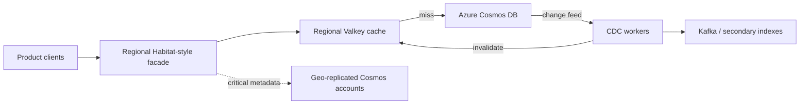

# Inside ChatGPT's 12× Faster Storage: OpenAI's Habitat, Cosmos DB, Global Caching and the Exabyte Roadmap

**Research date:** 25 October 2026  
**Primary announcement:** 23 October 2026  
**Editorial status:** Draft for review; performance figures are OpenAI-reported, not independently benchmarked.

## Executive summary

On 23 October 2026, OpenAI published Part II of its engineering account of **Habitat**, the online storage platform used by ChatGPT, Codex, the API, and internal services. The new report describes a storage architecture that manages **more than 500 PB**, serves applications used by **over one billion people**, and spans **40 geographic regions**. OpenAI reports reducing global **median storage-read latency** from approximately **120 ms to 10 ms**, a **12× improvement**. This is **not** a claim that complete ChatGPT responses are 12× faster. [1]

The more consequential engineering disclosures are how OpenAI:
1. Returned from broadly single-tenant database isolation to **multi-tenancy by default**, backed by better hot-key protection and workload controls.
2. Selectively geo-replicated critical small datasets instead of indiscriminately replicating everything.
3. Used regional **Valkey lookaside caches** and **Cosmos DB change-feed-driven invalidation** to keep cached data reasonably fresh.
4. Combined infrastructure improvements with a previously reported **Python-to-Rust service migration**.
5. Disclosed an **in-development**, custom exabyte-scale storage system combining the RocksDB Cloud core from Rockset with Raft-based replication. This system is **not described as generally available or fully deployed**. [1][2]

## What is new versus the September report?

| Date | Confirmed development | Why it matters |
|---|---|---|
| 11 Sep 2026 | Part I described the Habitat service, its narrow object/edge API, connection-pool issues, and the Rust rewrite assisted by Codex and GPT-5.5. | Established the service-layer story. |
| 23 Oct 2026 | Part II detailed Cosmos DB partition limits, noisy-neighbor mitigation, revised multi-tenancy, geo-placement, cache invalidation, CDC operations, and future exabyte storage. | New database-layer and data-platform architecture disclosures. |

**Scale context:** Part I reported over **70 million requests/second**, more than **500 PB**, and over **one billion weekly users**. Part II reports that the largest Cosmos DB account alone holds **tens of petabytes** and serves over **20 million queries/second**. These figures have different scopes and must not be conflated. [1][2]

## Architecture: a defensible conceptual model

[Editable Mermaid source](../../../architecture/2026-10-25-habitat-cosmosdb-global-cache.mmd)

This is a **teaching abstraction based on published components**, not an assertion that the exact production topology, deployment counts, or routing sequence are public. The separate diagram adds observability and policy controls as recommended implementation elements.

## Why the original multi-tenant approach broke down

OpenAI describes collisions when multiple clients used common logical partition keys such as `user_id` or `workspace_id`. Although Cosmos DB documentation describes logical-key throughput limits, multiple logical keys can share a physical partition and therefore contend for the same effective capacity. Noisy neighbors affected unrelated traffic, including critical login and signup paths. Growth-triggered physical partition splits also changed effective per-partition throughput. [1]

The company then isolated some workloads in dedicated containers. Isolation helped, but proliferating containers increased capacity-planning overhead and stranded capacity. Its newer approach is multi-tenancy by default, with capabilities for data movement, hot-key throttling, quality-of-service differentiation, and closer co-management with Azure. **Lesson:** Neither "one container for everything" nor "one container per tenant" is a universal answer; the workload's access pattern and isolation requirements should determine placement.

## Why the cache made such a difference

Habitat is predominantly read-heavy, and a relatively small set of frequently accessed object types contributes disproportionately to traffic. OpenAI placed **Valkey** lookaside caches near application compute. It uses the Cosmos DB **change feed** to distribute invalidations globally within seconds. An invalidated key is refreshed from backing storage on its next read. [1]

The architectural tradeoff is explicit: caching reduces latency and database load, but invalidation and replication lag create consistency windows. Teams should test cache invalidation lag, TTL fallback, missed events, consumer restarts, and regional partitions rather than assuming that "CDC = strong consistency."

For the most latency-sensitive and compact datasets, such as authentication metadata, OpenAI uses broad geographic replication; some accounts span all 40 Azure regions where it serves traffic. For larger datasets, the company favors caching and selective placement. The reported 12× median improvement reflects **combined** changes, including placement, caching, and the Rust service rewrite. It is not an isolated benchmark of Cosmos DB or Valkey. [1]

## CDC as a platform, not just a cache feature

The October report describes millions of changes per second, thousands of containers, millions of partitions, and more than 100 Kafka topics. The CDC layer also feeds secondary indexes, analytics, and data-movement pipelines. OpenAI discusses lease/checkpoint efficiency, dead-letter queues, failure isolation, and switching readers across regions. [1]

**Platform-engineering lesson:** CDC needs its own control plane, lag SLOs, idempotency strategy, replay controls, and failure handling. Treat it as a shared production subsystem, not a sidecar added after database deployment.

## Rust migration: important but not the new October claim

Part I, published in September, says two engineers working with Codex and GPT-5.5 rewrote the service in Rust during Q2 2026. At the time of that post, Rust handled 95% of production requests, with OpenAI reporting 6× better CPU efficiency and 15× better memory efficiency than the previous Python implementation. Those are OpenAI-reported service-efficiency comparisons, not the October 12× storage-read latency result. [2]

## The exabyte-scale roadmap

OpenAI says it is building an internal exabyte-scale storage system for bulky Habitat data. Its proposed design combines **RocksDB Cloud from Rockset**, **Raft-based replication**, disaggregated storage, and a Cosmos-compatible document model. The stated tradeoff is reduced flash capacity requirements in exchange for lower peak queries per second. [1]

Do **not** report this as a released database product, a confirmed replacement of Azure Cosmos DB, or an announced migration date. OpenAI does not disclose a production rollout schedule, total cost, or final footprint.

## Architecture decision records

### ADR-001 — A narrow storage API over unrestricted queries

**Context:** Unbounded queries can make request cost unpredictable and harm shared-service latency.  
**Decision:** Expose constrained object and edge operations through a centralized facade; route complex analytics to a separate query system.  
**Alternatives:** Direct database access; unrestricted SQL or graph queries.  
**Consequences:** Easier authorization, isolation and capacity planning, but less query expressiveness and more work for advanced consumers.  
**Validation:** Load tests with pathological fanout, authorization tests, and tenant-level cost accounting.

### ADR-002 — Multi-tenancy by default with explicit isolation exceptions

**Context:** Dedicated containers reduce contention but increase overhead and overprovisioning.  
**Decision:** Share by default, isolate critical or incompatible workloads, enforce hot-key throttling and priority controls, and support dataset movement.  
**Alternatives:** Fully shared or fully isolated storage.  
**Consequences:** Better utilization, at the cost of a more sophisticated control plane.  
**Validation:** Noisy-neighbor experiments, hot-partition stress, migration rollback, and priority traffic SLO tests.

### ADR-003 — Regional cache with CDC invalidation

**Context:** Read-heavy global workloads are sensitive to network round trips.  
**Decision:** Use regional lookaside caches, database change-feed invalidation, bounded TTL fallback, and observable invalidation lag.  
**Alternatives:** Direct reads only; TTL-only caches; synchronous write-through.  
**Consequences:** Lower typical latency, but eventual freshness and CDC operations become critical.  
**Validation:** Cache hit/miss benchmarks, stale-read tests, failover, event duplication, and consumer lag alerts.

### ADR-004 — Selective replication and residency-aware routing

**Context:** Replicating all data to every region is capacity-intensive.  
**Decision:** Replicate only compact, high-value datasets widely; route other datasets according to residency and latency policy.  
**Alternatives:** Full replication; centralized primary only.  
**Consequences:** Better cost/latency balance, but complexity in data movement, policy and consistency.  
**Validation:** Regional outage drills, residency compliance, p95/p99 across regions.

## Hands-on tutorial concept: reproduce the principles, not OpenAI's scale

**Lab:** One Azure Cosmos DB development account or emulator; a small Python/FastAPI or Rust facade; Valkey; a CDC consumer using the Cosmos change feed; k6 or Locust load generation; OpenTelemetry dashboards.

**Exercise 1 — Baseline:** Measure cache-disabled read p50/p95/p99, RU consumption, error rate, and throughput under a repeatable read-heavy workload.  
**Exercise 2 — Cache:** Add lookaside caching and record hit ratio, miss penalty, and consistency windows.  
**Exercise 3 — Invalidation:** Change a document and observe change-feed processing and the maximum age of a stale cached copy.  
**Exercise 4 — Noisy neighbor:** Generate a hot-key workload and test tenant throttling, priority classes, and isolation.  
**Exercise 5 — Failure:** Interrupt the CDC consumer, restart it, and verify checkpoint recovery and cache safety.  
**Exercise 6 — Multi-region design review:** Compare hypothetical selective replication versus broad replication with realistic latency and cost assumptions.

**Guardrails:** Use synthetic records, bounded request rates, nonproduction resources, and explicit cleanup. Never claim the lab reproduces OpenAI's production scale or its 12× result.

## YouTube opportunity assessment — 25 October 2026

**Keyword:** OpenAI Habitat architecture / ChatGPT 12x faster storage / Cosmos DB global caching.

**Demand evidence:** The October 23 primary disclosure generated same-day specialist coverage and further articles on October 24, including reports focused on the exabyte roadmap and Rust migration. This establishes fresh editorial attention, **not measured search-volume growth**. [3][4][5]

**Creator supply:** Targeted web searches restricted to YouTube-indexed pages for the exact Habitat/Cosmos DB announcement did not surface dedicated implementation walkthroughs. This is a **limited discoverability signal**, not proof of a comprehensive upload count.

**Audience:** Cloud architects, Azure engineers, SREs, platform engineers, backend developers, database engineers, DevOps teams, and AI-infrastructure builders.

**Recommended title:** **"How ChatGPT Made Database Reads 12× Faster — OpenAI's Hidden Storage Architecture"**

**Thumbnail:** **"120ms → 10ms"** / **"INSIDE CHATGPT"**

**Opening hook:**

> "OpenAI just revealed how the storage system behind ChatGPT and Codex reduced its median read time from about 120 milliseconds to 10. The surprising part isn't a bigger AI model—it's how the engineers combined Cosmos DB, global caches, smarter multi-tenancy, and a Rust service. Today, we'll unpack the architecture and build a smaller working version to see which design decisions actually matter."

**Urgency:** **Medium-high for specialist technical audiences; publish within 3–5 days** while the architecture disclosure is fresh. Demand and competition confidence are moderate-to-low; do not market this as a guaranteed viral topic.

## Source references

1. **Primary:** OpenAI, *Rapidly scaling online storage to serve over 1 billion ChatGPT users (Part II)*, 23 Oct 2026. https://openai.com/index/scaling-storage-one-billion-users-part-two/
2. **Primary:** OpenAI, *Rapidly scaling online storage to serve over 1 billion ChatGPT users (Part I)*, 11 Sep 2026. https://openai.com/index/scaling-storage-one-billion-users-part-one/
3. **Independent coverage:** FourWeekMBA, *OpenAI Is Building Exabyte Storage; Its Reads Got 12x Faster*, 23 Oct 2026. https://fourweekmba.com/ai-openai-is-building-exabyte-storage-its-reads-got-12x-faster/
4. **Independent coverage:** AI Weekly, *OpenAI Rewrites Habitat Storage in Rust With Codex, GPT-5.5*, 24 Oct 2026. https://aiweekly.co/alerts/openai-rewrites-habitat-storage-in-rust-with-codex-gpt-55
5. **Independent coverage:** AI Chat Daily, *OpenAI says its Habitat storage serves 1 billion users with 12x faster reads*, 24 Oct 2026. https://www.aichatdaily.com/ai-news/openai-says-habitat-storage-serves-1-billion-users

**Corrections policy:** Revalidate numerical claims, availability, and roadmap status against OpenAI's primary engineering publications before recording the video.
