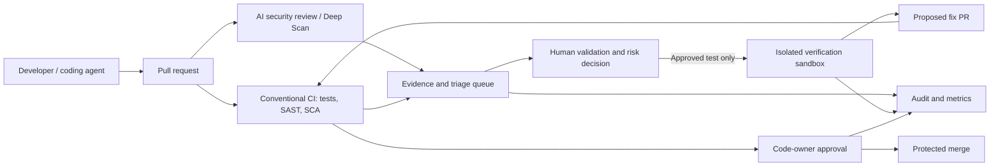

# OpenAI and CodeRabbit's $1M Security Scan Initiative: How to Evaluate AI-Powered Repository Security Before November 8

**Editorial status:** Draft for technical and source review · **Published evidence checked:** October 27, 2026  
**Audience:** DevSecOps, AppSec, platform engineers, GitHub/GitLab maintainers, AI coding teams, engineering managers.

## Executive summary

On **October 26, 2026**, CodeRabbit announced that it joined OpenAI's **Daybreak Defense Network** and committed **up to $1 million** toward free Deep Scan usage. Eligible organizations can receive **up to $5,000 per organization** while the allocation lasts, with a published claim window **through November 8, 2026**. Its Deep Scan currently uses frontier models including **GPT-6.1 Sol**. CodeRabbit says it *plans* to integrate OpenAI's specialized GPT cyber models through Daybreak; this is **not** a claim that those models are already generally available in Deep Scan.

This creates a practical, time-bounded opportunity for developers to evaluate whole-repository AI-assisted security review against their existing SAST, SCA, and manual review controls. The announcement is **not** evidence that every identified issue is exploitable or that AI scanning replaces conventional tools.

**Key primary sources:**
- [CodeRabbit newsroom, October 26 announcement](https://www.coderabbit.ai/newsroom/coderabbit-free-deep-scan-openai-daybreak)
- [CodeRabbit offer details and eligibility, October 24](https://www.coderabbit.ai/blog/one-million-security-scans-and-fixes)
- [OpenAI: GPT-6.1 Sol helps CodeRabbit strengthen security across complex codebases, October 26](https://openai.com/index/gpt-6-1-sol-coderabbit-code-security/)

## 1. What actually changed?

| Item | Verified description | Important limitation |
| --- | --- | --- |
| Daybreak participation | CodeRabbit joined OpenAI's Daybreak Defense Network | Participation does not itself prove a newly deployed cyber model |
| New promotional allocation | Up to **$1M** total Deep Scan usage covered | First-come, first-served; may be exhausted before the deadline |
| Per-organization amount | Up to **$5,000** in eligible Deep Scan usage | Organizations need **at least two members** per CodeRabbit's terms |
| Deadline | Through **November 8, 2026** | Check current terms before recording a demo |
| Current model | GPT-6.1 Sol is a primary model in the CodeRabbit security agent, alongside other models/tools | This is a vendor-described architecture, not an independent accuracy benchmark |
| Proposed future integration | OpenAI GPT cyber models are planned for CodeRabbit Secure | Do not present planned integration as live |
| Workflow | PR review, Deep Scan, cross-repo analysis, sandbox verification for selected findings, draft fix PR | Verification is conditional and human review remains required |

OpenAI's October 26 article describes how CodeRabbit's agent links behavior across files and repositories, including shared authentication libraries and dependency interactions. For user-selected findings, the system may attempt exploit verification **inside an isolated sandbox**, rather than on production systems, and can propose a fix PR for human review. [Source](https://openai.com/index/gpt-6-1-sol-coderabbit-code-security/)

CodeRabbit claims its security product found **more than 8,000 high- or critical-severity vulnerabilities across 600 organizations** over the prior 30 days; over **70%** reportedly involved broken access control, SQL injection, or authentication failures. Treat these as **company-reported findings**, not independently verified prevalence or confirmed exploitability rates. [Source](https://www.coderabbit.ai/newsroom/coderabbit-free-deep-scan-openai-daybreak)

## 2. Why this matters to enterprise DevSecOps

Traditional PR checks often focus on changed lines, known vulnerable packages, or recognizable patterns. A flaw can instead emerge from interactions among authorization code, routes, data access, and shared libraries. Whole-repository analysis may help find these interactions, but broad context introduces costs and risks: repository access, confidential source exposure, false positives, incomplete coverage, and remediation proposals that alter behavior.

A production security program should treat AI review as **one independent signal** within a controlled verification pipeline, not as a deploy authorization system.

### Threat and trust boundaries

1. Source repositories contain sensitive IP and may contain credentials accidentally committed. Grant minimal access, review vendor data handling, and use a synthetic repo for a public tutorial.
2. Scanner findings are **untrusted until validated**. A plausible explanation is not proof of reachability.
3. Verification must execute only in a disposable, network-restricted test environment with no production secrets or endpoints.
4. Proposed fix branches must pass normal CI, tests, code ownership, and human review.
5. Audit trails should capture scanner version/configuration, finding IDs, evidence, approvals, and dispositions.

## 3. Practical evaluation lab: compare AI scan with baseline controls

**Lab topology:** A dedicated synthetic repository, protected default branch, GitHub Actions or GitLab CI, baseline Semgrep/CodeQL (where licensed/available), dependency scanning, CodeRabbit Deep Scan, sandbox verification, human reviewer, and metrics collection. See [editable architecture diagram](../../../architecture/2026-10-27-coderabbit-daybreak-security-pipeline.mmd) and [design decisions](../../../architecture/2026-10-27-coderabbit-daybreak-design-decisions.md).

### Step A — Establish a safe baseline

Create a small, **non-production** sample service with unit tests and a deliberately flawed *synthetic* authorization path. Use only fake users, tokens, records, and data. Document expected findings and known benign patterns before running scanners.

Record:
- baseline scanner detections and false positives;
- median scan time and CI overhead;
- number of confirmed findings and reviewer effort;
- whether proposed changes preserve test behavior.

### Step B — Validate offer eligibility before connecting a repository

Review the [official offer](https://www.coderabbit.ai/blog/one-million-security-scans-and-fixes) and current [CodeRabbit product terms](https://www.coderabbit.ai/). The promotional allocation is first-come, first-served; the offer specifies an organization of two or more members. Product plans and trial requirements may still apply. A Reddit participant reported encountering an upgrade prompt, so do not promise that every account can activate the offer without additional steps. Do not connect private production code until security, legal, and procurement approvals are complete.

### Step C — Run a Deep Scan on the synthetic repository

Use the vendor's supported workflow, record scan scope, runtime, reported findings, evidence and remediation suggestions. Do not claim that this article performed a live scan: **no scan has been executed for this research package**.

### Step D — Independently triage findings

For each finding:
- classify affected code path and reachable entry point;
- confirm the preconditions with a unit/integration test in the sandbox;
- compare with baseline SAST/SCA;
- mark confirmed, not reproducible, informational, or needs investigation;
- track false positives and false negatives against the seeded test set.

Never run exploit tests against real third-party systems.

### Step E — Evaluate fix quality

Where a fix PR is proposed, inspect the diff, require code-owner review, execute CI, and check that the intended security property holds without breaking business logic. Avoid automatic merges or deployment on the basis of an AI score.

### Step F — Report meaningful metrics

Use a table like:

| Metric | Conventional checks | AI Deep Scan | Notes |
| --- | --- | --- | --- |
| Confirmed seeded issues found | TBD | TBD | Evaluate recall against known ground truth |
| False-positive findings | TBD | TBD | Independently triaged |
| Median scan time | TBD | TBD | Same commit and repository |
| Human review minutes | TBD | TBD | Include remediation time |
| Accepted fix PRs | N/A | TBD | Require human approval |
| Incremental cost | TBD | TBD | Include promotional and post-offer cost |

**Do not fill these cells with vendor claims.** The goal is a reproducible evaluation, not an advertisement.

## 4. Architecture and design choices

The diagram models **an evaluation/reference architecture**, not CodeRabbit's internal proprietary implementation.

Design decisions include: independent review separated from code generation; sandbox-only verification; no scanner authority to merge; minimal repository access; evidence-based triage; and a measurement-first pilot. See [ADR document](../../../architecture/2026-10-27-coderabbit-daybreak-design-decisions.md).

## 5. YouTube opportunity assessment (October 27)

**Primary keyword:** OpenAI CodeRabbit free AI security scan  
**Secondary keywords:** CodeRabbit Deep Scan tutorial, OpenAI Daybreak Defense Network, GPT-6.1 Sol code security, AI code review vs SAST.

**What is new:** The October 26 partnership and **time-limited $1M scan allocation** are materially new. The GPT-6.1 Sol model itself is **not** newly launched in this story.

**Demand evidence:** The vendor's October 26 release was covered by [Techzine on October 26](https://www.techzine.nl/nieuws/security/583155/coderabbit-voert-gratis-scans-uit-en-voegt-zich-bij-openai-initiatief/) and [Dutch IT Channel on October 27](https://www.dutchitchannel.nl/news/763582/coderabbit-en-openai-bundelen-krachten-voor-veiliger-broncode). A limited-time, no-charge evaluation creates a concrete reason for engineers to seek setup and validation guidance. These are **news attention and practical-intent signals**, not measured growth in YouTube search volume.

**Creator-supply evidence:** Targeted indexed searches for exact combinations of `CodeRabbit Deep Scan`, `GPT-6.1 Sol`, `$1M`, and `Daybreak Defense Network` returned no clearly identifiable dedicated YouTube walkthrough in this research pass. This suggests a *possible* low-supply niche; indexed search cannot establish upload counts, total creator supply, or future competition.

**Audience:** DevSecOps, AppSec, GitHub/GitLab administrators, open-source maintainers, platform engineers, AI-assisted coding teams.

**Recommended video title:** **OpenAI-Backed AI Security Scans Are Free Until Nov 8 — I Test CodeRabbit Deep Scan**

**Thumbnail:** **$5,000 SCANS?** / **FREE UNTIL NOV 8**

**Opening hook:**

> “A new OpenAI security partnership has opened a short window for engineering teams. CodeRabbit says it's covering up to five thousand dollars in AI-powered repository security scans per eligible organization, with one million dollars allocated overall. The deadline is November eighth—or earlier if the allocation runs out. But can an AI security agent actually find the authorization bugs your normal checks miss? I'll walk through the eligibility, run a safe test repository, compare the findings with conventional scanners, and show what a human must verify before accepting any suggested fix.”

**Urgency:** **High** for an eligibility-and-demo tutorial, ideally **October 27–30**. Offer expires November 8 or when allocation is depleted. Verify offer status immediately before publication. The title's first-person test wording **must be changed if no actual scan is performed**.

**Recommended production format:** 12–18 minutes: 90-second news/context, 2-minute eligibility and security warning, 7-minute real synthetic-repo demo, 3-minute independent validation, 2-minute architecture/limitations.

**Confidence:** New announcement high; practical audience interest moderate; low YouTube creator supply low-to-moderate. Do not imply confirmed search-volume growth.

## 6. Risks and caveats

- A marketing statement about 8,000 findings is not a measured false-positive rate or independently audited benchmark.
- Daybreak GPT cyber model integration is described as **planned**.
- The free allocation is limited, time-bounded, and subject to eligibility and product access.
- Third-party code scanning requires permission and data-governance review.
- Scanners can miss vulnerabilities; passing scans is not a security guarantee.
- OpenAI and CodeRabbit are distinct vendors with distinct product terms.
- A promotional free scan does not mean the product is free indefinitely.

## 7. Primary and supporting references

1. CodeRabbit (Oct 26, 2026), [CodeRabbit commits $1M in free security scans, joins OpenAI Daybreak Defense Network](https://www.coderabbit.ai/newsroom/coderabbit-free-deep-scan-openai-daybreak).
2. CodeRabbit (Oct 24, 2026), [For the next two weeks, we're covering $1 million in security scans and fixes](https://www.coderabbit.ai/blog/one-million-security-scans-and-fixes).
3. OpenAI (Oct 26, 2026), [GPT-6.1 Sol helps CodeRabbit strengthen security across complex codebases](https://openai.com/index/gpt-6-1-sol-coderabbit-code-security/).
4. Techzine (Oct 26, 2026), [CodeRabbit voert gratis scans uit en voegt zich bij OpenAI-initiatief](https://www.techzine.nl/nieuws/security/583155/coderabbit-voert-gratis-scans-uit-en-voegt-zich-bij-openai-initiatief/).
5. Dutch IT Channel (Oct 27, 2026), [CodeRabbit en OpenAI bundelen krachten voor veiliger broncode](https://www.dutchitchannel.nl/news/763582/coderabbit-en-openai-bundelen-krachten-voor-veiliger-broncode).
6. OpenAI, [API changelog](https://developers.openai.com/api/docs/changelog) (model release chronology and developer changes).
7. CodeRabbit, [Product and plan information](https://www.coderabbit.ai/).

*Editorial note: All company performance figures are attributed to the companies. No live CodeRabbit scan, purchase, or independent YouTube analytics measurement was performed for this article.*
