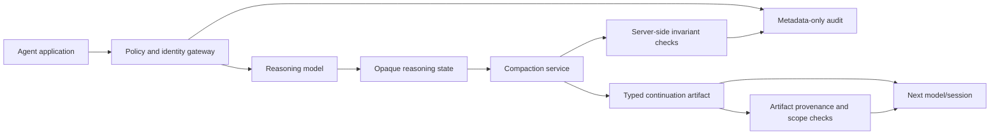

# Compaction Smuggling: The OpenAI Reasoning-Trace Leak and What It Teaches Us About Agent Memory Security

**Research date:** October 27, 2026  
**Audience:** AI engineers, DevSecOps, platform engineers, agent builders, model-platform security teams  
**Editorial status:** Draft for human review; not a claim that OpenAI's API remains exploitable.

## Executive summary

On October 26, 2026, security firm Xint published a technical report describing **Compaction Smuggling**, a flaw in how encrypted context-compaction artifacts interacted with encrypted reasoning artifacts in the OpenAI API. Xint reports that OpenAI confirmed the issue, deployed an undisclosed fix on **October 23**, and paid a **$6,000 bounty**. The research describes a way to induce a server-side compaction operation to preserve sensitive reasoning material and later recover readable content via a separate model. This was a **model-intellectual-property and trust-boundary issue**, not evidence of arbitrary code execution, a server takeover, or a currently unpatched flaw. [1][2]

The lasting lesson is larger than one bug: agent memory, context compaction, cross-model state portability, and tool-generated summaries are security-sensitive transformations. Encrypting an artifact at rest or in transit is not enough if a privileged transformation can be steered to disclose its contents.

## What changed and when

| Date | Event | Confidence |
| --- | --- | --- |
| August 2026 | Earlier research, *Stealing Reasoning Traces from Proprietary LLM APIs*, showed that encrypted reasoning artifacts could sometimes be replayed across model boundaries. Providers deployed mitigations. | Primary research summarized by Xint [1][3] |
| August 2026 | Xint says it found a distinct bypass using compaction and disclosed it responsibly. | Researcher statement [1] |
| October 23, 2026 | Xint says OpenAI confirmed and fixed the issue, with a $6,000 bounty. Fix details were not disclosed. | Researcher statement; SecurityWeek corroboration [1][2] |
| October 26, 2026 | Xint published the technical write-up; SecurityWeek reported it the same day. | Confirmed publication [1][2] |
| October 27, 2026 | Additional developer/security coverage appeared. | Secondary reporting [4] |

**Scope caveat:** Xint's write-up describes its experiments on particular model combinations and API behavior at the time of testing. Do not generalize this to all OpenAI models, all compaction workflows, or any current API exploitability. Xint explicitly says it cannot prove recovered traces were token-for-token identical to the inaccessible originals. [1]

## Understanding the architecture

OpenAI reasoning models can return opaque encrypted reasoning artifacts that clients may pass into later requests without reading their plaintext. Context compaction reduces long conversation state into a smaller continuation artifact. These mechanisms are useful for long-running coding agents, but they cross multiple trust boundaries: the application, a privileged server-side transformation, model-generated continuation state, and subsequent model invocations. OpenAI documents compaction as a supported API feature. [1][5]

The vulnerability arose when the compaction path could be influenced to preserve information that was intended to remain inaccessible to API clients. The resulting encrypted compaction artifact could then be consumed in a different model context. A boundary intended to keep hidden reasoning opaque was therefore not enforced consistently across the two artifact types. [1]

**This is a conceptual explanation, not an exploit recipe.** For defenders, the interesting issue is artifact type confusion and inconsistent access controls between adjacent API features.

### Architecture views

- [Editable Mermaid architecture diagram](../../../architecture/2026-10-27-compaction-smuggling-defense.mmd)
- [Design decisions and controls](../../../architecture/2026-10-27-compaction-smuggling-decisions.md)



The diagram is a **proposed defensive reference architecture**, not a depiction of OpenAI's internal deployed fix.

## Security implications for enterprises

**1. Encrypted state is not equivalent to safe state.** If the service handling encrypted state can interpret client instructions and re-express secrets, encryption alone cannot enforce confidentiality. Protect the transformations, not only the storage.

**2. Compaction output should be treated as untrusted continuation state.** Generated summaries may contain accidental instructions, sensitive data, and stale assumptions. A summary must not inherit developer/system authority just because it is convenient for the next agent turn.

**3. Cross-model portability is a privileged feature.** Where state moves across models, versions, tenants, or projects, enforce explicit compatibility, provenance, identity, and authorization rules.

**4. Logging can itself leak protected material.** Record artifact IDs, hashes, lengths, origin model, purpose, request identity, policy decisions, and anomalous access patterns; do not indiscriminately log hidden reasoning or secrets.

**5. Provider-managed fixes and customer responsibilities differ.** Xint reports that OpenAI fixed this particular issue server-side. Customers generally cannot patch the provider's model infrastructure themselves. Their work is to review agent design, data classification, permissions, incident response, and any application-owned memory or compaction services.

## Defensive implementation pattern

A production-grade agent gateway should:
1. Authenticate every application and service identity, with tenant/project separation.
2. Treat opaque reasoning artifacts and compaction artifacts as **different security types**.
3. Bind each artifact to origin model, owner, permitted consumer, expiry, and authorized purpose.
4. Validate all artifact transitions server-side rather than trusting model text or user-supplied labels.
5. Prevent summaries from creating new privileges or changing policy.
6. Apply data-minimization and redaction rules before durable memory storage.
7. Use metadata-only security telemetry and anomaly detection.
8. Require human review for high-impact changes to agent memory or model routing.

These are proposed controls. Public reporting does not establish which specific controls OpenAI used in its undisclosed fix.

## Safe demonstration plan (10–14 minutes)

Build a **fully synthetic local simulator** of an agent-memory pipeline. Use a dummy string such as `INTERNAL_TEST_ONLY` instead of real model reasoning or API secrets.

- **Baseline:** A naive state transformer converts an opaque synthetic state into a free-form summary. Show why downstream consumers should not assume the summary is trustworthy.
- **Improved design:** Add typed artifact metadata, an origin/scope check, allowed-consumer rules, and a policy gate before state can be passed to another simulated model.
- **Negative tests:** Reject cross-tenant replay, cross-purpose reuse, expired artifacts, unauthorized model switching, and attempts to promote summary text into system-level instructions.
- **Observability:** Show request IDs, policy decisions, artifact hashes, and denial events without storing secret contents.
- **Outcome:** Compare the naive and hardened designs using pass/fail assertions, not by attempting the historical exploit against OpenAI's live API.

Do **not** reproduce the disclosed extraction workflow against production services. The educational value is in showing the control failure class and a verifiable defensive architecture.

### Example policy invariants

```text
artifact.tenant == request.tenant
artifact.purpose in request.allowed_purposes
request.consumer_model in artifact.allowed_consumers
artifact.expires_at > now()
artifact.type == expected_input_type
summary.role != system
summary.role != developer
```

These are conceptual invariants, not actual OpenAI API fields.

## YouTube opportunity assessment

**Proposed video title:** *OpenAI Patched a Hidden AI Reasoning Leak — Is Your Agent Memory Secure?*

**Alternative technical title:** *Compaction Smuggling Explained: The AI Agent Memory Security Flaw*

**Thumbnail:** `AI REASONING LEAK?` / `PATCHED OCT 23`

**Opening hook:**

> "A security team found a way to make encrypted AI reasoning appear in a place it was never meant to appear: an agent's compacted memory. OpenAI says the issue has been fixed. But the design lesson matters to every developer building long-running AI agents. Today we'll explain the trust-boundary mistake and build a safe, testable defense—without exploiting a live service."

**Keywords:** OpenAI compaction smuggling; AI agent memory security; encrypted reasoning leak; context compaction; reasoning trace; agent trust boundary; LLM API security.

**Demand signals:** Xint published the research on October 26; SecurityWeek published same-day reporting; further coverage appeared on October 27. Social posts from Xint researchers drew attention in specialist security circles. This supports **fresh niche interest**, not a verified increase in YouTube search volume. [1][2][4]

**Creator supply:** Targeted indexed searches for exact-match “Compaction Smuggling” YouTube videos returned no clear dedicated technical walkthroughs in this scan. That is **weak evidence** of low discoverable supply, not a reliable total upload count; indexing may lag and competing generic “AI reasoning leak” videos may exist.

**Audience fit:** High for DevSecOps, AI platform, coding-agent, and enterprise security audiences; moderate for general AI news.

**Urgency:** **High, 24–48 hours** while the disclosure is fresh. Prefer a defensible technical explanation over a sensational “OpenAI hacked” claim.

**Opportunity score:** 8/10 for a specialized security channel, with medium confidence due to limited demand and supply metrics.

## What this does NOT establish

- No evidence in the cited sources that the issue remains exploitable after October 23.
- No evidence that ordinary ChatGPT conversations were publicly exposed.
- No evidence of a remote-code-execution vulnerability, a CVE, or arbitrary infrastructure compromise.
- No proof that the recovered output was byte-for-byte identical to the original hidden reasoning.
- No proof that a competitor used this particular technique to train a model.
- No proof of low YouTube competition based on comprehensive upload statistics.

## Editorial verification checklist

- [x] Researcher disclosure and publication date checked.
- [x] Independent security coverage checked.
- [x] Fix date and bounty attributed to Xint rather than claimed as an OpenAI press release.
- [x] Official compaction documentation linked.
- [x] Safe demonstration and design decisions provided.
- [ ] Independently reproduce a benign **local** defensive demo.
- [ ] Collect YouTube Studio/Google Trends metrics before assigning numerical demand growth.
- [ ] Confirm final thumbnail and title after editorial review.

## Sources

1. Xint / Tim Becker, **Stealing OpenAI Reasoning Traces via Compaction Smuggling**, October 26, 2026: https://xint.io/blog/compaction-smuggling-reasoning-traces
2. SecurityWeek / Kevin Townsend, **Stolen AI Reasoning Could Help China Build Cheaper Rivals**, October 26, 2026: https://www.securityweek.com/stolen-ai-reasoning-could-help-china-build-cheaper-rivals/
3. Panfilov et al., **Stealing Reasoning Traces from Proprietary LLM APIs** (linked by Xint): https://arxiv.org/search/?query=Stealing+Reasoning+Traces+from+Proprietary+LLM+APIs&searchtype=all
4. TechGig, **OpenAI flaw enabled cheaper rival AI model distillation**, October 27, 2026: https://techgig.com/news/ai/openai-flaw-enabled-cheaper-rival-ai-model-distillation/135221628
5. OpenAI, **Compaction API guide**: https://developers.openai.com/api/docs/guides/compaction
6. OpenAI, **Agents API overview**: https://openai.com/index/introducing-the-agents-api/

*Research note: The primary disclosure was available and read on October 27, 2026. Technical specifics in this article are intentionally limited to defensive architectural analysis.*
