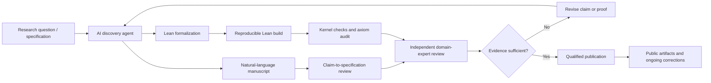

# OpenAI Says AI Refuted the Exponential Time Hypothesis: What the Lean Proof Actually Establishes

**Research and editorial review:** 27 October 2026. **Editorial caution:** This is a major research claim with public formal artifacts and an independent examination underway. Do not report that the mathematics community has already accepted every implication.

## Executive summary

On **26 October 2026**, OpenAI announced three model-generated results in mathematics, theoretical computer science, and physics. The most directly relevant to software engineering is a claimed refutation of the **Exponential Time Hypothesis (ETH)**, a widely used conjecture about the asymptotic difficulty of satisfiability (SAT). OpenAI reports that its system generated a natural-language disproof on **16 October** and formalized it in **Lean** on **17 October**. The company published both a manuscript and a Lean artifact, and invited an independent group led by Russell Impagliazzo, Ramamohan Paturi, and Ryan Williams to examine and explain the result.

This is **not a proof that P = NP**, does **not** mean all NP-hard problems are now practical to solve, and does **not** demonstrate a production-ready SAT solver outperforming existing tools. The potentially groundbreaking claim concerns the asymptotic running time of a carefully specified deterministic algorithm.

**Primary disclosure:** https://openai.com/index/building-scientific-understanding-with-academic-communities/

**Formalization scope:** https://github.com/openai/math/blob/main/lean/docs/378.md

**Paper:** https://github.com/openai/math/blob/main/preprints/The-Exponential-Time-Hypothesis-is-False-October-25-2026/paper.pdf

## 1. What changed?

OpenAI's 26 October release differs from ordinary benchmark marketing: it provides public mathematical artifacts and a pathway for external scrutiny. The announcement covers:

1. A claimed proof of the local smoothing conjecture in all dimensions, with implications for Kakeya and restriction conjectures.
2. A claimed disproof of ETH, formalized in Lean and made public.
3. A claimed rigorous existence result for certain four-dimensional interacting quantum field theories, including QCD and Yang–Mills-related results. The physics group is delaying public release of its proof materials while examining them.

The ETH result has the clearest immediately inspectable artifact for computer scientists. OpenAI's `lean/docs/378.md` describes the formal statement as exact counting of satisfying assignments of canonically encoded fixed-width CNF formulas using subexponential time and polynomial space. The stated time bound is
`(L+1)^{O_k(1)} 2^{O_k(n (log log n)^2 / sqrt(log n))}`, with `L` the encoding length. The October 25 manuscript describes a sharper bound under its stated assumptions. This is asymptotic mathematics: constants, implementation overhead, and practical instance distributions matter.

**Evidence:** OpenAI disclosure and the linked scope document above.

## 2. What ETH actually means

The Exponential Time Hypothesis concerns worst-case complexity of solving 3-SAT as the number of variables grows. It is stronger than simply assuming `P != NP`. A subexponential-time 3-SAT algorithm would contradict ETH, but need not run in polynomial time. It therefore does **not** settle the P-versus-NP problem.

ETH is widely used as a conditional premise in fine-grained complexity results, including graph algorithms, computational biology, and database query problems. If the announced result survives review, researchers may need to revisit results explicitly conditional on ETH. It would not automatically invalidate unconditional theorems, make cryptographic systems insecure, or imply practical speedups in commercial solvers.

## 3. Why Lean verification matters — and what it does not guarantee

Lean is a proof assistant that checks formal terms against formal statements. This can substantially reduce certain kinds of logical errors compared with informal manuscript review.

However, the key questions remain:

- Does the formalized theorem exactly capture the claimed ETH refutation?
- Are the encoding assumptions, computational model, and asymptotic statements aligned with standard ETH definitions?
- Are any axioms, external trust assumptions, or toolchain details relevant?
- Does the public artifact compile and check under documented dependency versions?
- Can independent specialists explain the algorithm, not merely re-run the checker?

A successful machine check is important evidence **about a formal proposition**. Human scrutiny is still needed to connect that proposition to the intended mathematical and computational claim.

**Inspect the scope before making claims:** https://github.com/openai/math/blob/main/lean/docs/378.md

## 4. Independent scrutiny and confidence

OpenAI names **Russell Impagliazzo, Ramamohan Paturi, and Ryan Williams** as leaders of the independent ETH review effort. The first two helped originate the ETH line of research. The company says the reviewers are independent and that raw artifacts are public.

The Verge and TechCrunch covered the claim on 27 October, giving the story broad technical visibility. These reports are not equivalent to a peer-reviewed acceptance of the theorem.

- https://www.theverge.com/ai-artificial-intelligence/1019143/openai-eth-kaseya-science-math-physics
- https://techcrunch.com/2026/10/27/frontier-ai-labs-say-their-models-refuted-the-exponential-time-hypothesis-what-does-that-mean/

Other reports say Anthropic independently released a similar ETH result on 27 October. That is a developing comparison; do not present independent discovery, exact equivalence of the algorithms, or verification of either manuscript as settled without checking the original repositories and expert commentary.

## 5. Practical developer relevance

**AI-assisted formal methods:** The strongest immediate tutorial is how to inspect, run, and audit machine-checked mathematical artifacts.

**Agentic research workflows:** An architecture for AI-generated claims should separate generation, formalization, independent checking, specification review, and publication approval.

**Software verification:** The same trust-boundary lesson applies to AI-generated program proofs, policy checks, smart-contract verification, and infrastructure-as-code invariants.

**No premature operational claims:** This announcement does not justify changing production SAT solver configurations, security policies, or cryptographic choices.

## 6. Suggested hands-on video lab

Build a **small, independently understandable Lean 4 exercise**, not a reproduction of the entire ETH manuscript:

1. Pin a Lean toolchain version and dependencies in a clean container or reproducible environment.
2. Formalize a simple proposition about Boolean assignments (e.g., show an explicit assignment satisfies a toy CNF).
3. Run the Lean checker and inspect any admitted axioms or unsafe assumptions.
4. Intentionally change the proposition so the proof no longer checks.
5. Explain the difference between **theorem verification** and **specification correctness**.
6. Navigate the public OpenAI ETH scope document and identify the theorem, encoding, and complexity bounds without claiming to have independently audited the full proof.
7. For an advanced follow-up, reproduce the public artifact in a pinned environment and document resource requirements, build logs, warnings, and any remaining uncertainties.

Suggested evaluation metrics: reproducibility, toolchain pinning, number of explicit axioms, specification-to-claim mapping, independent review coverage, and time-to-verify.

## 7. Architecture: AI research with verification gates

See [editable Mermaid diagram](../../../architecture/2026-10-27-openai-eth-lean-verification.mmd) and [architecture decision record](../../../architecture/2026-10-27-openai-eth-lean-verification-decisions.md).

## 8. YouTube opportunity assessment

**Primary keyword:** OpenAI ETH proof Lean 4

**Secondary:** Exponential Time Hypothesis false, AI mathematical discovery, Lean formal verification, AI theorem proving, 3-SAT, P vs NP explained.

**What changed:** A fresh official 26 October announcement plus public manuscript and Lean artifact. This is a research result, **not** a new API/model release or DevDay product launch.

**Evidence of demand:** Major same-day coverage on 27 October from The Verge, TechCrunch, and other technology publications; substantial significance for complexity theory and AI research. These are news-attention signals, **not measured YouTube search growth**.

**Evidence of low creator supply:** Targeted web-indexed YouTube searches for the exact OpenAI/ETH/Lean combination did not surface a dedicated practical walkthrough at the time of review. Older general Lean/AI proof videos do exist. This is a **weak-to-moderate supply signal**, not a comprehensive YouTube inventory.

**Target audience:** AI engineers, computer science students, software verification engineers, researchers, developer educators, and technically curious viewers.

**Suggested title:** **OpenAI Says AI Broke a 25-Year Computer Science Assumption — Let's Check the Proof**

**Thumbnail:** **AI BROKE ETH?** / **LEAN PROOF CHECK**

**Opening hook:** "OpenAI says its AI discovered a result that challenges one of computer science's most widely used assumptions. And unlike a normal AI benchmark, there's a public Lean proof to inspect. Does this mean P equals NP? No. Today we'll unpack the claim, see what the proof checker actually verifies, and explain what experts still need to establish."

**Urgency:** High for an accurate explainer within 24–48 hours; moderate for a rigorous lab within a week. **Do not rush a claim that the proof is fully accepted.**

**Opportunity confidence:** Demand: medium-high based on mainstream and specialist coverage. Low supply: low-medium because video indexing is incomplete. Overall editorial priority: **8/10**, subject to review.

## 9. Publication guardrails

Avoid these claims unless independently established:
- "OpenAI solved P versus NP."
- "Every NP-hard problem is now easy."
- "All modern encryption is broken."
- "Lean proves every interpretation of the research paper is correct."
- "The independent review is finished."
- "The new algorithm beats today's SAT solvers in real workloads."

## References (accessed 27 October 2026)

1. OpenAI, *Working with academic communities to build scientific understanding* (26 Oct): https://openai.com/index/building-scientific-understanding-with-academic-communities/
2. OpenAI, *The Exponential Time Hypothesis is False* (manuscript): https://github.com/openai/math/blob/main/preprints/The-Exponential-Time-Hypothesis-is-False-October-25-2026/paper.pdf
3. OpenAI, *Lean formalization scope* (ETH): https://github.com/openai/math/blob/main/lean/docs/378.md
4. The Verge, report on OpenAI's scientific claims (27 Oct): https://www.theverge.com/ai-artificial-intelligence/1019143/openai-eth-kaseya-science-math-physics
5. TechCrunch, explainer on frontier labs' ETH claims (27 Oct): https://techcrunch.com/2026/10/27/frontier-ai-labs-say-their-models-refuted-the-exponential-time-hypothesis-what-does-that-mean/
6. Lean project (tooling): https://lean-lang.org/

**Revision policy:** Update the status and conclusions when independent reviewers publish their assessment or reproducibility evidence changes.
