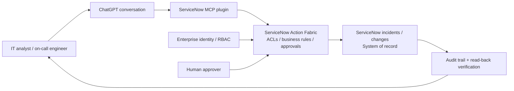

# ChatGPT Can Now Act in ServiceNow: What the New MCP Plugin Changes for Enterprise IT

**Research date:** October 28, 2026  
**Category:** New enterprise agent integration / ITSM / secure tool use  
**Editorial recommendation:** **High-priority niche video, publish within 24–72 hours if access is available.**  
**Important distinction:** This is an expansion of an earlier partnership, not the first OpenAI–ServiceNow collaboration.

## Executive summary

On **October 28, 2026**, OpenAI and ServiceNow announced an expanded partnership. The **ServiceNow MCP plugin is available in the OpenAI marketplace as of the announcement date**, allowing ChatGPT to access ServiceNow business context and perform permitted workflow actions. ServiceNow's **Action Fabric** remains the enforcement point for existing business rules and permissions. Examples described by the vendors include locating related incidents, evaluating change risk and updating an authorized ServiceNow record without switching away from ChatGPT.

This matters because it moves beyond a read-only question-answering demonstration into **governed actions against a system of record**. It is a potentially strong tutorial opportunity for ITSM administrators, SREs, platform engineers, security teams and enterprise AI architects. **Do not claim the exact available plugin actions, subscription requirements, regions, or access tiers without checking them in a real tenant**; the announcements do not enumerate all of these.

The same announcement also discusses **future** OpenAI-powered cybersecurity, Codex application development and voice risk-assessment integrations. Those are *not* generally available today.

## Verified announcement timeline and availability

| Item | Status on Oct 28, 2026 | Why it matters |
|---|---|---|
| OpenAI–ServiceNow partnership | Existing relationship expanded from January 2026 | Avoid portraying the relationship itself as new. |
| **ServiceNow MCP plugin in OpenAI marketplace** | **Available now, per both companies** | Practical immediate hook for an authorized tenant demonstration. |
| Enhanced ServiceNow plugin capabilities | Expected by end of 2026 | Do not show preview examples as generally available. |
| Voice-driven AI risk assessments in Super Intelligence Control Tower | Expected Q1 2027 | Future roadmap, not current tutorial. |
| Joint OpenAI/ServiceNow cybersecurity solution | Early access expected January 2027; GA planned Q2 2027 | Future capability; do not claim deployability. |
| Codex in ServiceNow AI Workflow Factory | Expected in 2027 | Future capability. |

**Primary sources:** [OpenAI announcement](https://openai.com/index/openai-servicenow-partnership-expansion/) and [ServiceNow newsroom announcement](https://newsroom.servicenow.com/press-releases/details/2026/ServiceNow-and-OpenAI-accelerate-enterprise-AI-from-models-and-operations-to-cybersecurity-and-agentic-development/default.aspx).

## What technically changed?

### Before: assistant advice, human context switching

A common IT operations workflow involves reading a monitoring alert, opening the ITSM system, finding similar incidents, assessing impact, choosing an assignment group and updating an incident. A standalone chat assistant can help reason about the alert but usually cannot complete authorized actions without an integration.

### Now: chat-to-governed workflow

The announced integration is designed to connect:

1. **ChatGPT conversation** — user describes the incident or change.
2. **ServiceNow MCP plugin** — exposes approved ServiceNow capabilities to ChatGPT.
3. **ServiceNow Action Fabric** — applies enterprise business rules and permission checks.
4. **ServiceNow records/workflows** — remain the system of record for the actual action.
5. **Operator verification** — checks the resulting incident/change record and audit trail.

A useful distinction: the model may propose *what to do*, but ServiceNow must still enforce *whether the requested user/action is authorized*. Human approval remains appropriate for high-impact changes even when the connector supports execution.

### Security and compliance implications

- **Least privilege:** connect as a user/identity with only required read/update capabilities; avoid unrestricted administrator accounts.
- **Authorization at execution:** do not assume model instructions are a security boundary. Confirm the ServiceNow server enforces roles, ACLs and workflow approvals.
- **Prompt injection:** incident descriptions, comments and external alerts are untrusted text; they must not be treated as instructions granting access or overriding approvals.
- **Data minimization:** ticket text may include employee, customer or infrastructure details. Confirm organizational data-handling policy before enabling access.
- **Auditability:** correlate ChatGPT requests, plugin invocation IDs, ServiceNow transaction IDs and record updates where available.
- **Approval gates:** use explicit approval for high-impact change records, user entitlements, security exceptions or destructive actions.
- **Idempotency and concurrency:** repeated agent requests should not create duplicate incidents or overwrite newer human changes.
- **Reliability:** timeouts, rate limits, partial writes and connector unavailability require clear failure handling and read-back verification.
- **Multi-tenancy:** ensure no cross-instance or cross-tenant record access; test negative permission cases.

The announcement asserts inherited governance through Action Fabric, but does not independently establish how every enterprise configuration behaves. **Test controls in the actual tenant.**

## YouTube opportunity assessment

**Primary keyword:** ServiceNow ChatGPT MCP plugin tutorial  
**Related keywords:** OpenAI ServiceNow Action Fabric, ChatGPT ITSM incident automation, ServiceNow MCP security, ChatGPT ServiceNow integration 2026.

### Demand signals (what is and is not established)

- A **newly available integration** was announced by **both vendors on October 28**, creating an immediate reason for practitioners to search for setup and permissions guidance.
- The news was distributed through the ServiceNow newsroom, Business Wire, financial news services and specialist AI coverage on the same day.
- ServiceNow reports **more than 100 billion workflows per year** on its platform. This is an enterprise-scale installed-base indicator, **not** proof of YouTube demand for the new plugin.
- No reliable public YouTube search-volume time series was obtained. **Rising YouTube demand is plausible but not independently quantified.**

**Demand confidence: moderate** (fresh announcement and substantial enterprise relevance, not verified search-volume acceleration).

### Creator supply and competition

Targeted web-indexed searches on October 28 for the exact combinations **"ServiceNow ChatGPT MCP plugin"**, **"ServiceNow ChatGPT Action Fabric"** and **"ServiceNow ChatGPT plugin October 2026"** did not surface a clear set of dedicated, current walkthrough videos. Existing generic ServiceNow MCP material does exist; for example, a July 30 ServiceNow Community tutorial covers MCP Apps and Claude Desktop, **not** this newly announced ChatGPT plugin.

This is a **narrow discovery gap**, not a measured count of YouTube uploads. Search indexing may lag the announcement. Recheck YouTube directly before publishing.

**Supply confidence: low–moderate.** The opportunity is differentiated by a hands-on, governance-aware ITSM demonstration, not by claiming no competitors.

### Proposed video

**Title:** **ChatGPT Can Now Update ServiceNow Tickets — But Can IT Trust It? (New MCP Plugin)**

**Alternative title:** **OpenAI + ServiceNow Just Changed IT Support: Live Incident Workflow & Security Test**

**Thumbnail text:**  
**CHATGPT → SERVICENOW**  
**REAL TICKET UPDATES?**

**Target audience:** ServiceNow admins, ITSM managers, SREs, DevOps engineers, enterprise architects, helpdesk automation teams, GRC and security practitioners.

**Opening hook:**

> "OpenAI and ServiceNow have just released an integration that lets ChatGPT work with real enterprise IT workflows. Instead of merely suggesting how to fix an incident, the assistant can use approved ServiceNow actions to help investigate it and update records. But there's a critical question: who decides what the AI is actually allowed to change? Today we'll walk through the new MCP plugin, test an incident workflow in a sandbox and check whether the enterprise permissions and approvals still hold."

**Urgency:** High for a niche technical channel. Aim for **October 29–31, 2026**. If a real tenant is unavailable, publish a **verified architecture/explainer** rather than implying a working demo.

## Recommended reproducible demonstration

### Preconditions

- An **authorized non-production ServiceNow instance** with synthetic incident/change records.
- Access to the newly announced plugin in an eligible ChatGPT environment. Confirm actual listing, permissions and required account tier before recording.
- Two test personas: **helpdesk analyst** (limited update scope) and **ITSM administrator/approver**.
- Synthetic alerts and dummy service ownership data; no real customer PII.
- An audit log and a simple table of expected versus observed actions.

### Suggested demo sequence

1. **Baseline:** Open a synthetic incident directly in ServiceNow and document current permissions.
2. **Connect:** Show the actual plugin setup and consent flow *only if available*; otherwise present a labeled conceptual integration.
3. **Read:** Ask ChatGPT to find a synthetic incident and related historical incidents.
4. **Propose:** Ask for a recommended assignment group and change-risk assessment.
5. **Write with authorization:** As the analyst, update a permitted incident field; verify the exact result in ServiceNow.
6. **Negative test:** Attempt a restricted record update or privileged action; expect server-side denial.
7. **Approval test:** For a consequential action, require explicit human approval and verify no action occurs beforehand.
8. **Injection-resilience test:** Place harmless adversarial instructions inside a synthetic ticket description and confirm they do not override the requested workflow or authorization.
9. **Resilience test:** Simulate connector timeout and retry; inspect whether duplicates or stale writes occur.
10. **Evidence:** Show ServiceNow record history and any available audit entries; distinguish product guarantees from observed results.

**Evaluation table:** Record task, test persona, expected authorization, actual outcome, latency, record state before/after, audit evidence, and any manual intervention. Do not claim the integration is secure solely because one negative test passes.

### If the plugin is not available to your tenant

Use a **clearly labeled ServiceNow-style mock** backed by FastAPI and a minimal synthetic incident database. Implement a tool gateway that checks identity, role and approval before executing writes. The demonstration illustrates the **architecture pattern**; it does **not** test the real plugin or prove ServiceNow's actual behavior.

## Architecture

See [editable Mermaid reference diagram](../../../architecture/2026-10-28-openai-servicenow-mcp-itsm-reference.mmd) and [architecture decisions](../../../architecture/2026-10-28-openai-servicenow-mcp-itsm-design-decisions.md).

**Trust boundary:** All model-generated requests and ticket text are untrusted inputs; permission decisions belong to the enterprise workflow platform.

## Risks, unknowns and editorial safeguards

- **Do not** promise a live integration for all ChatGPT users; availability in the marketplace does not establish every user's entitlement.
- **Do not** imply the joint security product, Codex workflow factory integration or voice risk assessment is already GA.
- **Do not** assert undocumented MCP endpoint names, scopes, pricing, tenant setup steps or specific audit fields.
- **Do not** demonstrate with production incidents or sensitive data.
- **Do not** equate press coverage with measured YouTube search-volume growth.
- Record a tenant-verified walkthrough first; if access is blocked, switch to an accurate architecture video.

## Sources and verification links

1. [OpenAI — OpenAI and ServiceNow expand partnership across enterprise workflows (October 28, 2026)](https://openai.com/index/openai-servicenow-partnership-expansion/) — official status, features, roadmap.
2. [ServiceNow Newsroom — ServiceNow and OpenAI accelerate enterprise AI (October 28, 2026)](https://newsroom.servicenow.com/press-releases/details/2026/ServiceNow-and-OpenAI-accelerate-enterprise-AI-from-models-and-operations-to-cybersecurity-and-agentic-development/default.aspx) — partner confirmation, Action Fabric and availability.
3. [ServiceNow Community — Getting started with MCP Apps in MCP Server Console (July 30, 2026)](https://www.servicenow.com/community/servicenow-otto-articles/getting-started-with-mcp-apps-in-mcp-server-console/ta-p/3581618) — prior generic MCP tutorial, not evidence of the new plugin's operation.
4. [Unite.AI — OpenAI and ServiceNow expand partnership with ChatGPT workflow plugin (October 28, 2026)](https://www.unite.ai/openai-and-servicenow-expand-partnership-with-chatgpt-workflow-plugin/) — independent specialist coverage, secondary.
5. [Investing.com — ServiceNow expands OpenAI partnership with ChatGPT plugin (October 28, 2026)](https://www.investing.com/news/company-news/servicenow-expands-openai-partnership-with-chatgpt-plugin-93CH-4980655) — same-day distribution.

**Last verified:** October 28, 2026. Product access, implementation details and roadmap dates can change. This is research and an implementation plan, **not** a claim that a live tenant was tested.
