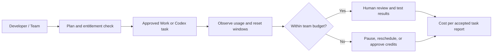

# OpenAI Reverses the Pro 200 Codex Cut and Doubles Work/Codex Usage on Other Pro Tiers

**Verified October 31, 2026.** A material correction to OpenAI's September 29 DevDay subscription changes arrived on **October 29**: the planned Pro 200 Work/Codex allowance reduction was canceled. Pro 100 and Pro 500 now include **twice their previous Work/Codex allowance**, while Pro 200 accounts that previously had the lower allowance were raised to match the higher one. Existing Pro 200 accounts already at the higher allowance retain it. The release-note heading also mentions Business Premium, but **does not quantify the Business Premium increase**.

## Why this matters

The earlier DevDay announcement created an October 29 grandfathering deadline and concern that existing Pro 200 subscribers would lose included coding-agent capacity while keeping the same subscription price. OpenAI reversed that plan on the deadline. This is not a new model, new API or a change to API token prices; it is an **included-usage policy change** affecting the economics of agentic coding and ChatGPT Work.

### Verified plan-level changes

| Plan | October 29 announcement | Interpretation |
| --- | --- | --- |
| Pro 100 | Twice the previous Work and Codex allowance | More included agentic-work capacity; not a guarantee of twice the completed tasks |
| Pro 200 (already higher allowance) | Keeps higher allowance; announced reduction canceled | Avoids the scheduled cut; **not** an additional doubling for these users |
| Pro 200 (previously lower allowance) | Allowance doubled to match the higher allowance | Accounts on the lower level catch up |
| Pro 500 | Twice the previous Work and Codex allowance | More included capacity; Ultrafast eligibility remains a separate plan feature |
| Business Premium | Release-note heading says usage increases | Specific increase/allowance not stated in the cited release notes |
| Plus | No change announced in this release note | Do not imply an increase |

**Caution:** The official release notes do not give absolute task counts or token allowances. Do not publish an invented "requests per day" number. The amount of work possible varies with task complexity, model, context, reasoning, and speed mode. Pro usage is not equivalent to OpenAI API usage or API credits.

## Evidence of demand and competitive opportunity

- The original planned reduction generated public confusion and dissatisfaction in [r/codex on October 11](https://www.reddit.com/r/codex/comments/1x3al7v/what_is_everyones_plan_after_29th_october_when/) and in a [September 29 discussion](https://www.reddit.com/r/ChatGPTPro/comments/1wtlnvz/removed/). These are **pre-reversal** signals of strong interest in the allowance question, not direct measurements of post-reversal demand.
- Independent follow-up coverage appeared on [October 29](https://kingy.ai/blog/openai-cancels-chatgpt-pro-usage-cut-doubles-allowances/), [October 30](https://propakistani.pk/2026/10/30/openai-doubles-chatgpt-pro-usage-limits-without-raising-prices/), and [October 31](https://onthewire.ai/article/openai-cancels-pro-200-cut-and-doubles-work-and-codex-allowances-on-pro-100-and-).
- Targeted indexed searches performed October 31 for YouTube videos on the **October 29 Pro 200 cancellation** and **Pro 100/500 Codex doubling** did not surface dedicated walkthroughs. This is a **weak supply signal**, not a verified YouTube-wide upload count. Search indexing is incomplete, and the topic may quickly attract coverage.
- Search-volume growth, CTR, and conversion rates have **not** been measured. Treat this as a timely editorial hypothesis with **moderate demand confidence and low-to-moderate supply confidence**.

## YouTube production brief

**Keyword:** OpenAI Codex usage limits October 2026 / ChatGPT Pro 200 allowance reversal

**Recommended title:** **OpenAI CANCELS the Codex 50% Cut — Who Gets 2× More Usage?**

**Thumbnail:** `CODEX CUT CANCELED!` / `2× MORE?`

**Audience:** Codex power users, software developers, DevOps/platform engineers, AI-agent builders, startup engineering leads, and Business workspace administrators.

**Opening hook (45 seconds):**

> "OpenAI told Pro 200 subscribers that their Codex and ChatGPT Work allowance was about to shrink. Then, on the deadline, it reversed the decision. Pro 100 and Pro 500 users now get twice their previous included Work and Codex usage—and some Pro 200 users are getting an increase too. But not every Pro 200 account actually doubles, and none of this means API tokens are free. Let's check the official release notes, see who benefits, and compare the real capacity you can use for coding projects."

**Urgency:** **High, 24–48 hours**, because the October 29 reversal corrects an imminent and controversial policy change. Score: **8.0/10** for a narrowly focused developer audience. This is a provisional editorial rating, not a quantified market forecast.

## Suggested accurate on-screen demonstration

1. Show the October 29 [official ChatGPT release note](https://help.openai.com/en/articles/6825453-chatgpt-release-notes) and the relevant [Business release note](https://help.openai.com/en/articles/11391654-chatgpt-business-release-notes).
2. Open an account with appropriate access, display **Settings → Usage** in ChatGPT or **Usage & Billing** in Codex, and **redact identifiers, payment details, and workspace information**. If an eligible account is not available, show a clearly labeled illustrative mockup.
3. Explain two distinct Pro 200 starting states: previously higher allowance **unchanged** versus previously lower allowance **raised**. Avoid the blanket headline "all Pro 200 users get double".
4. Demonstrate a fixed synthetic coding task (tests + code review) and capture usage before/after **within one plan and model**. This illustrates usage accounting, **not** a historical before/after quota test unless archived measurements are available.
5. Explain that different speed modes and reasoning workloads consume allowance differently. Avoid claiming the new policy makes individual model calls cheaper or increases API credits.
6. For teams, propose a simple capacity-planning worksheet: task category, model, time spent, observed usage, human review time, and success criteria. Compare cost per accepted task, not only headline allowance.

## Governance architecture

The accompanying [Mermaid diagram](../../../architecture/2026-10-31-codex-usage-governance.mmd) models an enterprise policy for measuring included usage and avoiding unexpected credit spend. It is **recommended reference architecture**, not a description of OpenAI's internal billing implementation.

## Design decisions

See [architecture decision record](../../../architecture/2026-10-31-codex-usage-governance-decisions.md).

## What remains uncertain

- Exact numeric Work/Codex allowances for every tier, as OpenAI's public announcement states **relative** changes.
- Business Premium's exact increase.
- Actual usage changes in any specific user's account; no authenticated entitlement test was conducted.
- Total number of competing YouTube videos and independently measured search growth.

## References (primary sources first)

1. [OpenAI ChatGPT release notes — October 29, 2026](https://help.openai.com/en/articles/6825453-chatgpt-release-notes)
2. [OpenAI ChatGPT Business release notes — October 29, 2026](https://help.openai.com/en/articles/11391654-chatgpt-business-release-notes)
3. [OpenAI Pro tiers and usage guidance](https://help.openai.com/en/articles/9793128-about-chatgpt-pro-tiers) — note that help pages can be updated asynchronously; the dated release note controls the October 29 announcement.
4. [r/codex discussion — October 11, 2026](https://www.reddit.com/r/codex/comments/1x3al7v/what_is_everyones_plan_after_29th_october_when/)
5. [r/ChatGPTPro discussion — September 29, 2026](https://www.reddit.com/r/ChatGPTPro/comments/1wtlnvz/removed/) — thread is partially removed; comments preserve reactions.
6. [Kingy AI — October 29, 2026](https://kingy.ai/blog/openai-cancels-chatgpt-pro-usage-cut-doubles-allowances/)
7. [ProPakistani — October 30, 2026](https://propakistani.pk/2026/10/30/openai-doubles-chatgpt-pro-usage-limits-without-raising-prices/)
8. [On The Wire — October 31, 2026](https://onthewire.ai/article/openai-cancels-pro-200-cut-and-doubles-work-and-codex-allowances-on-pro-100-and-)
